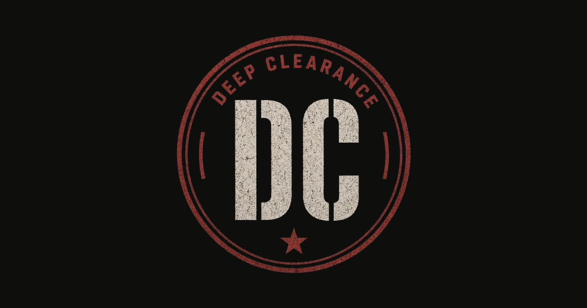

# Deep Clearance

  

Understand the system. Challenge the narrative.

Primary-source research on institutional power. Every answer comes with the source attached.

[deepclearance.com](https://deepclearance.com)

---

The public story is what a chemical company, a court, or an agency was willing to say. The documents show what they did, and what they spent to keep the rest quiet. Deep Clearance searches those documents.

The index is stored passages. It is not a live web crawl. About 1,476,000 passages sit under one standard, with the source attached to the answer. Classified documents stay outside the index.

A connected model keeps mixed labels apart, names a missing label, and stops when the index has no passage. Login does not mint a free key.

## How a passage is labeled

Every passage carries two labels. Strength is what that passage can support. Depth is how far the writeup goes. A claim keeps the labels of the passages it actually uses.

**Strength**

- **S1** means the page shows the act. The dollar figure in a filing is S1 for that figure. An audit finding is S1 for the finding the report states. A lawsuit is S1 for what it alleges. A judgment, or another page that records the act, is what shows the act happened.
- **S2** means the papers force the conclusion even though no single page names it. If the contracts in the index cannot work unless someone is coordinating them, that coordination is S2.
- **S3** means it fits, and the documents do not rule it out, but they do not force it either. Motive, intent, and hidden coordination usually land here.
- **S4** means they said it about themselves. A press release, an official statement, or testimony about their own plans shows that they said it. A reason someone gives for an act stays S4 unless a different passage backs that reason.

**Depth**

Depth is not a second copy of strength. A government report can still quote a weak excuse. An essay can still quote a real filing.

- **T1** stays with what the institution put on paper. Filings, testimony, contracts, audits, and what that paper shows they did.
- **T2** is how the network got built. Who set it up, what they were paid to do, how the pattern spread. That only counts when the T1 papers are under it.
- **T3** is one argument, standing on its own, with the points that would knock it down written down.
- **T4** uses more than one of those arguments together, after each one has been checked on its own.

The branded subject gets read second. When a subject has been called misinformation, deplatformed, or litigated into silence, the first pass is the suppression itself. Who paid for it, when it started, and what form it took come before the branded claim.

## What is in the index

Company files from chemical, drug, and oil firms. Court records, including the Epstein releases. Released CIA and FBI files. Patents. Federal Reserve transcripts from the 2008 crisis. The federal accounting standard for classified defense spending. Congressional hearings, oversight audits, contract awards, sanctions notices, SEC filings, and State human-rights reports. Interviews and talks, with the speaker named. Books as short excerpts. Research on financial control, institutional power, technology suppression, and the secrecy record.

Every plan searches the same documents. A plan buys days and a daily cap. Trial is 50 queries a day. Researcher is 250. Control is 500.

## How to start

1. Sign in with GitHub or Nostr.
2. Pay with Lightning. An upgrade keeps the same key.
3. Connect over MCP at [mcp.deepclearance.com/mcp](https://mcp.deepclearance.com/mcp). Claude uses OAuth from the [account](https://deepclearance.com/account/) page. Cursor and other clients send a Bearer key.
4. Ask. The passage comes back with the source attached.

## Where to read

| | |
| --- | --- |
| Product | [deepclearance.com](https://deepclearance.com) |
| Methodology | [How the labels stay apart](https://deepclearance.com/methodology/) |
| Docs | [Endpoint, tools, topic pins, caps](https://deepclearance.com/docs/) |
| Plans | [Trial, Researcher, Control](https://deepclearance.com/pricing/) |
| Checkout | [Start or change a plan](https://deepclearance.com/subscribe/) |
| Security | [Keys, checkout, and the index](https://deepclearance.com/security/) |
| Support | [Billing and keys](https://deepclearance.com/support/) |
| Terms | [Terms](https://deepclearance.com/terms/) |
| Privacy | [Privacy](https://deepclearance.com/privacy/) |

## Tools

| Tool | What it returns |
| --- | --- |
| `search` | Cited passages. If the reply says the index had no passage, stop there. |
| `get_passage` | The stored excerpt for a cite. Not a live crawl. |
| `verify_claim` | Whether a stored excerpt supports a claim. The judge is not a source. |
| `get_snapshot` | A dated report, replayed. It does not count against the daily cap. |
| `corruption_lookup` | Corruption events by actor, jurisdiction, mechanism, and date. Each event keeps its own standard. |
| `pattern_query` | A network or mechanism, with the events and cited passages. Each claim keeps its own standard. |

Pass `source` as one pin, or omit it to search the whole index. Pins include `financial_control`, `epstein_record`, `declassified_record`, `industry_record`, `wire`, `contractor_layer`, `postwar_record`, `disclosure_pressure`, `secrecy_labels`, `origin_literature`, `shelf`, `fiction_contamination`, and `system`. The [docs](https://deepclearance.com/docs/) hold the full list.

## Repositories

| Repo | What it is |
| --- | --- |
| [deepclearance.com](https://github.com/DeepClearance/deepclearance.com) | Source for the public site. |
| [.github](https://github.com/DeepClearance/.github) | This organization profile. |
